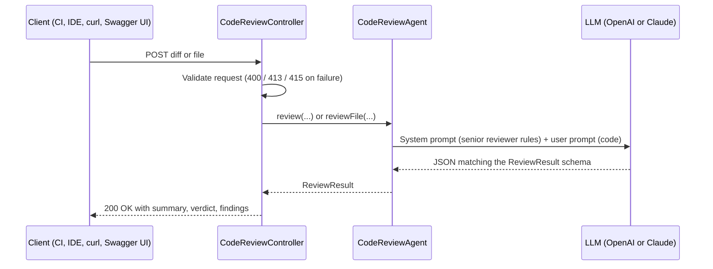

# Spring Boot AI Code Review Agent

An AI-powered code review service built with Spring Boot and Spring AI. Send it a code diff or a source file and it returns a structured review: a summary, an overall verdict, and a list of actionable findings.

The API works with both **OpenAI** (GPT) and **Anthropic** (Claude) models. You choose the provider and model through configuration, with no code changes: set `AI_PROVIDER` to `openai` or `anthropic`, and optionally `OPENAI_MODEL` or `ANTHROPIC_MODEL`, as environment variables or command-line arguments. The endpoints, request formats and JSON responses are identical for every provider, so clients don't need to know which model is behind the service. See [Run](#run) for examples and [Configuration](#configuration) for all settings.

## Features

- Reviews diffs or whole files for bugs, security issues, performance problems, maintainability concerns and missing tests
- Returns structured JSON (not free text), mapped directly to Java records
- Verdict logic: `REQUEST_CHANGES` if any finding is `MAJOR` or `CRITICAL`, `COMMENT` for minor findings only, otherwise `APPROVE`
- REST API with request validation, accepting JSON or multipart file uploads
- Health and info endpoints via Spring Boot Actuator
- Swagger UI for trying out the API in the browser
- Works with OpenAI or Anthropic Claude models; provider and model are chosen by configuration (defaults: OpenAI `gpt-4o-mini`, Claude `claude-haiku-4-5`)

## Tech stack

- Java 25
- Spring Boot 4.1.1 (Web MVC, Validation, Actuator)
- Spring AI 2.0.1 with the OpenAI and Anthropic model starters
- springdoc-openapi 3.1.1 (OpenAPI spec and Swagger UI)
- Maven (wrapper included)

## Getting started

### Prerequisites

- JDK 25
- An API key for the provider you want to use: OpenAI or Anthropic

### Run

Three settings control which model reviews the code:

| Setting             | Values                             | Default            |
|---------------------|------------------------------------|--------------------|
| `AI_PROVIDER`       | `openai` or `anthropic`            | `openai`           |
| `OPENAI_MODEL`      | Any OpenAI chat model              | `gpt-4o-mini`      |
| `ANTHROPIC_MODEL`   | Any Claude model ID                | `claude-haiku-4-5` |

Each setting can be given as an environment variable or as a command-line argument (`--AI_PROVIDER=anthropic`). Command-line arguments take precedence over environment variables.

Only the selected provider's API key is needed: `OPENAI_API_KEY` or `ANTHROPIC_API_KEY`. Always pass the key as an environment variable. A key given as a command-line argument is visible in the process list and shell history.

A running instance uses one provider. Restart it to switch, or run two instances on different ports (see below).

#### Option A: Maven wrapper (development)

Runs straight from source; no build step needed.

OpenAI, Windows PowerShell:

```powershell
$env:OPENAI_API_KEY="sk-..."
$env:OPENAI_MODEL="gpt-4o"            # optional, defaults to gpt-4o-mini
.\mvnw.cmd spring-boot:run
```

OpenAI, macOS / Linux:

```bash
export OPENAI_API_KEY="sk-..."
export OPENAI_MODEL="gpt-4o"          # optional, defaults to gpt-4o-mini
./mvnw spring-boot:run
```

Anthropic Claude, Windows PowerShell:

```powershell
$env:AI_PROVIDER="anthropic"
$env:ANTHROPIC_API_KEY="sk-ant-..."
$env:ANTHROPIC_MODEL="claude-sonnet-4-5"   # optional, defaults to claude-haiku-4-5
.\mvnw.cmd spring-boot:run
```

Anthropic Claude, macOS / Linux:

```bash
export AI_PROVIDER="anthropic"
export ANTHROPIC_API_KEY="sk-ant-..."
export ANTHROPIC_MODEL="claude-sonnet-4-5" # optional, defaults to claude-haiku-4-5
./mvnw spring-boot:run
```

PowerShell environment variables last for the current session. If you switch providers in the same window, set `AI_PROVIDER` again or clear it with `Remove-Item Env:AI_PROVIDER`.

#### Option B: Executable jar (deployment)

Build the jar once:

```bash
./mvnw clean package          # Windows: .\mvnw.cmd clean package
```

This produces `target/spring-boot-ai-sdlc-code-review-agent-0.0.1-SNAPSHOT.jar`. Add `-DskipTests` to skip the tests.

OpenAI, Windows PowerShell:

```powershell
$env:OPENAI_API_KEY="sk-..."
java -jar target\spring-boot-ai-sdlc-code-review-agent-0.0.1-SNAPSHOT.jar --OPENAI_MODEL=gpt-4o
```

OpenAI, macOS / Linux:

```bash
export OPENAI_API_KEY="sk-..."
java -jar target/spring-boot-ai-sdlc-code-review-agent-0.0.1-SNAPSHOT.jar --OPENAI_MODEL=gpt-4o
```

`--AI_PROVIDER=openai` is optional because OpenAI is the default. Add it to make the choice explicit, or to override an `AI_PROVIDER=anthropic` variable left over in the environment. Omit `--OPENAI_MODEL` to use `gpt-4o-mini`.

Anthropic Claude, Windows PowerShell:

```powershell
$env:ANTHROPIC_API_KEY="sk-ant-..."
java -jar target\spring-boot-ai-sdlc-code-review-agent-0.0.1-SNAPSHOT.jar --AI_PROVIDER=anthropic --ANTHROPIC_MODEL=claude-sonnet-4-5
```

Anthropic Claude, macOS / Linux:

```bash
export ANTHROPIC_API_KEY="sk-ant-..."
java -jar target/spring-boot-ai-sdlc-code-review-agent-0.0.1-SNAPSHOT.jar --AI_PROVIDER=anthropic --ANTHROPIC_MODEL=claude-sonnet-4-5
```

Omit `--ANTHROPIC_MODEL` to use `claude-haiku-4-5`.

#### Option C: Both providers side by side

To compare reviews from both providers on the same code, run two instances on different ports:

```powershell
# Window 1: OpenAI on port 8080
$env:OPENAI_API_KEY="sk-..."
java -jar target\spring-boot-ai-sdlc-code-review-agent-0.0.1-SNAPSHOT.jar --AI_PROVIDER=openai

# Window 2: Claude on port 8081
$env:ANTHROPIC_API_KEY="sk-ant-..."
java -jar target\spring-boot-ai-sdlc-code-review-agent-0.0.1-SNAPSHOT.jar --AI_PROVIDER=anthropic --server.port=8081
```

Then send the same request to `http://localhost:8080` and `http://localhost:8081`.

#### Check that it works

The service is ready when the log shows `Started SpringBootAiSdlcCodeReviewAgentApplication`. It listens on `http://localhost:8080` unless you set `--server.port`. Send a sample review:

```powershell
$body = @{
    fileName = "UserService.java"
    language = "java"
    content  = @"
public class UserService {
    public User find(Connection conn, String name) throws SQLException {
        Statement st = conn.createStatement();
        ResultSet rs = st.executeQuery("SELECT * FROM users WHERE name = '" + name + "'");
        return rs.next() ? new User(rs.getString("name")) : null;
    }
}
"@
} | ConvertTo-Json

Invoke-RestMethod -Method Post -Uri http://localhost:8080/api/reviews/file `
    -ContentType "application/json" -Body $body | ConvertTo-Json -Depth 5
```

Or upload a file from disk:

```bash
curl -X POST http://localhost:8080/api/reviews/file/upload -F "file=@UserService.java" -F "language=java"
```

On Windows, use `curl.exe` rather than `curl`, which is an alias for `Invoke-WebRequest` in Windows PowerShell.

The response looks like this (wording varies between models and runs):

```json
{
  "summary": "The query is built by string concatenation, which allows SQL injection, and JDBC resources are never closed.",
  "verdict": "REQUEST_CHANGES",
  "findings": [
    {
      "file": "UserService.java",
      "line": 4,
      "severity": "CRITICAL",
      "category": "SECURITY",
      "message": "User input is concatenated into the SQL query, enabling SQL injection.",
      "suggestion": "Use a PreparedStatement with a ? placeholder and setString."
    }
  ]
}
```

#### Troubleshooting

| Symptom                                              | Cause and fix                                                                 |
|------------------------------------------------------|-------------------------------------------------------------------------------|
| `500` response, log shows `invalid x-api-key` or `authentication_error` | Anthropic key is missing or wrong. Check `ANTHROPIC_API_KEY`        |
| `500` response, log shows `401` or `Incorrect API key` from OpenAI       | OpenAI key is missing or wrong. Check `OPENAI_API_KEY`             |
| `500` response, log mentions an unknown or invalid model                 | The `OPENAI_MODEL` or `ANTHROPIC_MODEL` value is not a valid model ID |
| The wrong provider answers                           | An old `AI_PROVIDER` value is still set in the shell. Pass `--AI_PROVIDER=...` explicitly |
| `Port 8080 was already in use`                       | Another instance is running. Stop it or add `--server.port=8081`              |

### Swagger UI

Interactive API docs are available once the app is running:

- Swagger UI: http://localhost:8080/swagger-ui.html
- OpenAPI spec (JSON): http://localhost:8080/v3/api-docs

Use **Try it out** on any endpoint to send a request. The `/api/reviews/file/upload` endpoint shows a file picker for the upload.

### Build and test

```bash
./mvnw verify
```

No real API key is needed to build. The tests never call a real model; `StubChatModel` stands in for it and can return a fixed reply or throw an error.

| Test class                      | Type        | What it covers                                                              |
|---------------------------------|-------------|-----------------------------------------------------------------------------|
| `CodeReviewAgentTests`          | Unit        | Prompt construction, JSON format instructions, mapping model replies (including no findings, null line numbers and Markdown-fenced JSON), and failures on invalid replies or model errors |
| `CodeReviewControllerTests`     | Web slice   | Every endpoint with the agent mocked: field mapping, file name handling, UTF-8 content, and 400 / 415 responses |
| `CodeReviewIntegrationTests`    | Integration | Full HTTP request through controller, agent and Spring AI with a stub chat model |
| `ErrorResponseIntegrationTests` | Integration | Real embedded server: error body format and 400, 404, 405, 413, 415 and 500 responses |
| `ChatModelProviderTests`        | Integration | Provider selection: OpenAI by default, Anthropic via `AI_PROVIDER`, model overrides, no OpenAI key needed for Anthropic |
| `OpenApiDocsTests`              | Integration | OpenAPI spec: endpoints, summaries, required fields, enum values, file upload schema, and Swagger UI |
| `ActuatorEndpointsTests`        | Integration | Health and info are exposed; sensitive endpoints such as `env` and `beans` are not |
| `ApplicationMainTests`          | Smoke       | The application starts through its `main` method with either provider       |

`./mvnw verify` also writes a JaCoCo coverage report to `target/site/jacoco/index.html`.

## API reference

### Overview

| Endpoint                         | Content type          | Reviews                  | Typical SDLC stage                         |
|----------------------------------|-----------------------|--------------------------|--------------------------------------------|
| `POST /api/reviews`              | `application/json`    | A diff (changed lines)   | Pre-commit, pull request, CI pipeline      |
| `POST /api/reviews/file`         | `application/json`    | One full source file     | Development, IDE or script integration     |
| `POST /api/reviews/file/upload`  | `multipart/form-data` | One uploaded source file | Manual review, Swagger UI, quick checks    |

- **Base URL:** `http://localhost:8080`
- **Authentication:** none. Put the service behind a gateway or add Spring Security before exposing it outside a trusted network.
- **Behavior:** every call is synchronous and makes one request to the language model. Expect a response in a few seconds to tens of seconds, depending on input size.
- **Determinism:** results come from an LLM (temperature `0.2`), so the same input can produce slightly different findings between calls.
- **Data handling:** the submitted code is sent to the configured model provider (OpenAI by default, or Anthropic). Do not submit code you are not allowed to share with that provider.

### How a review works



1. The controller validates the request and, for uploads, reads the file as UTF-8 text.
2. `CodeReviewAgent` sends the code to the model with a system prompt that sets the reviewer's role, what to look for, and the verdict rules.
3. Spring AI asks the model for output that matches the `ReviewResult` JSON schema and converts the reply into Java records.
4. The structured result is returned unchanged to the client.

### Response: `ReviewResult`

All three endpoints return `200 OK` with this JSON body.

| Field      | Type               | Description                                              |
|------------|--------------------|----------------------------------------------------------|
| `summary`  | string             | Short overall assessment of the code                     |
| `verdict`  | enum               | `APPROVE`, `COMMENT` or `REQUEST_CHANGES` (see below)    |
| `findings` | array of `Finding` | Individual issues found; empty when nothing is reported  |

`Finding`:

| Field        | Type            | Description                                                         |
|--------------|-----------------|---------------------------------------------------------------------|
| `file`       | string          | File the finding refers to                                          |
| `line`       | integer or null | Line number when the model can point to one, otherwise `null`       |
| `severity`   | enum            | `INFO`, `MINOR`, `MAJOR`, `CRITICAL`                                |
| `category`   | enum            | `BUG`, `SECURITY`, `PERFORMANCE`, `MAINTAINABILITY`, `STYLE`, `TESTING` |
| `message`    | string          | What the problem is                                                 |
| `suggestion` | string          | How to fix it                                                       |

Verdict meaning:

| Verdict           | Meaning                                         | Suggested action in a pipeline |
|-------------------|-------------------------------------------------|--------------------------------|
| `APPROVE`         | No actionable findings                          | Pass                           |
| `COMMENT`         | Only `INFO` or `MINOR` findings                 | Pass, surface the comments     |
| `REQUEST_CHANGES` | At least one `MAJOR` or `CRITICAL` finding      | Fail or block the merge        |

The verdict rules are given to the model in its system prompt. They are not re-checked in code, so treat the verdict as the model's judgment.

Example response:

```json
{
  "summary": "The change builds a SQL query via string concatenation, which is vulnerable to SQL injection.",
  "verdict": "REQUEST_CHANGES",
  "findings": [
    {
      "file": "UserService.java",
      "line": 1,
      "severity": "CRITICAL",
      "category": "SECURITY",
      "message": "User input is concatenated directly into a SQL query.",
      "suggestion": "Use a parameterized query or PreparedStatement."
    }
  ]
}
```

---

### `POST /api/reviews` — review a diff

Reviews only the changed lines in a diff, such as `git diff` output. Best suited for pull requests and CI, where you care about what changed rather than the whole file.

- **Content type:** `application/json`
- **Operation:** `CodeReviewController.review` → `CodeReviewAgent.review`

Request body (`ReviewRequest`):

| Field      | Type   | Required | Constraints  | Description                                              |
|------------|--------|----------|--------------|----------------------------------------------------------|
| `diff`     | string | yes      | Not blank    | The diff to review, in unified diff format               |
| `language` | string | no       | —            | Programming language, for example `java`. Sent as `unknown` if omitted |
| `context`  | string | no       | —            | What the change is for, ticket text, or reviewer hints. Sent as `unknown` if omitted |

Example with curl:

```bash
curl -X POST http://localhost:8080/api/reviews \
  -H "Content-Type: application/json" \
  -d '{
        "language": "java",
        "context": "Adds a user lookup endpoint",
        "diff": "diff --git a/UserService.java b/UserService.java\n+ String sql = \"SELECT * FROM users WHERE name = '\''\" + name + \"'\''\";"
      }'
```

Example with PowerShell, reviewing your uncommitted changes:

```powershell
$body = @{
    language = "java"
    context  = "Refactor of the review controller"
    diff     = git diff | Out-String
} | ConvertTo-Json
Invoke-RestMethod -Method Post -Uri http://localhost:8080/api/reviews -ContentType "application/json" -Body $body
```

Responses: `200` with a `ReviewResult`, `400` if `diff` is missing or blank or the JSON is malformed, `415` if the content type is not JSON, `500` if the model call fails.

---

### `POST /api/reviews/file` — review a file sent as JSON

Reviews the entire contents of one source file. The model is told it is looking at a full file (not a diff), that line numbers are 1-based, and to use `fileName` as the file of every finding. Best suited for scripts and IDE integrations that already have the file contents in memory.

- **Content type:** `application/json`
- **Operation:** `CodeReviewController.reviewFile` → `CodeReviewAgent.reviewFile`

Request body (`FileReviewRequest`):

| Field      | Type   | Required | Constraints | Description                                                  |
|------------|--------|----------|-------------|--------------------------------------------------------------|
| `fileName` | string | yes      | Not blank   | File name or path, used in the `file` field of each finding  |
| `content`  | string | yes      | Not blank   | Full contents of the file                                    |
| `language` | string | no       | —           | Programming language. Sent as `unknown` if omitted           |
| `context`  | string | no       | —           | What the file does or what to focus on. Sent as `unknown` if omitted |

Example with curl:

```bash
curl -X POST http://localhost:8080/api/reviews/file \
  -H "Content-Type: application/json" \
  -d '{"fileName":"Foo.java","language":"java","content":"public class Foo { }"}'
```

Example with PowerShell, reviewing a file from disk:

```powershell
$path = ".\src\main\java\org\example\codereview\review\CodeReviewAgent.java"
$body = @{
    fileName = Split-Path $path -Leaf
    language = "java"
    context  = "Focus on prompt construction and error handling"
    content  = Get-Content -Raw $path
} | ConvertTo-Json
Invoke-RestMethod -Method Post -Uri http://localhost:8080/api/reviews/file -ContentType "application/json" -Body $body
```

Responses: `200` with a `ReviewResult`, `400` if `fileName` or `content` is missing or blank or the JSON is malformed, `415` if the content type is not JSON, `500` if the model call fails.

---

### `POST /api/reviews/file/upload` — review an uploaded file

Same review as `POST /api/reviews/file`, but the file is sent as a multipart upload. The file name is taken from the upload (any directory part is stripped), and the bytes are read as UTF-8. Best suited for manual checks and Swagger UI.

- **Content type:** `multipart/form-data`
- **Operation:** `CodeReviewController.reviewUploadedFile` → `CodeReviewAgent.reviewFile`

Form parts:

| Part       | Type   | Required | Constraints                     | Description                         |
|------------|--------|----------|---------------------------------|-------------------------------------|
| `file`     | file   | yes      | Not empty, UTF-8 text, max 1 MB | The source file to review           |
| `language` | string | no       | —                               | Programming language                |
| `context`  | string | no       | —                               | What the file does or what to focus on |

Example with curl:

```bash
curl -X POST http://localhost:8080/api/reviews/file/upload \
  -F "file=@src/main/java/org/example/codereview/review/CodeReviewAgent.java" \
  -F "language=java" \
  -F "context=Focus on prompt construction"
```

On Windows, use `curl.exe` (not the `curl` alias of `Invoke-WebRequest`) with the same arguments.

Responses: `200` with a `ReviewResult`, `400` if the `file` part is missing or the file is empty or only whitespace, `413` if the file is larger than 1 MB, `415` if the request is not multipart, `500` if the model call fails.

---

### Error responses

Errors use Spring Boot's default error format:

```json
{
  "timestamp": "2026-10-16T08:58:19.129Z",
  "status": 400,
  "error": "Bad Request",
  "path": "/api/reviews"
}
```

| Status | When it happens                                                                 |
|--------|---------------------------------------------------------------------------------|
| `400`  | A required field is missing or blank, the JSON is malformed, the `file` part is missing, or the uploaded file is empty |
| `413`  | The uploaded file is larger than the multipart limit (1 MB by default). The body is empty |
| `415`  | The `Content-Type` does not match the endpoint (JSON vs multipart)              |
| `500`  | The model call failed, for example an invalid or missing API key, a provider outage, or a reply that could not be parsed into `ReviewResult` |

Validation details are not included in the body by default. To include them, set `server.error.include-message=always` and `server.error.include-binding-errors=always`. Validation failures are also logged by the server.

### Using the API in the SDLC

**Pre-push or pre-commit check.** Review your local changes before pushing:

```bash
jq -n --rawfile diff <(git diff --cached) '{language: "java", diff: $diff}' \
  | curl -s -X POST http://localhost:8080/api/reviews -H "Content-Type: application/json" -d @- \
  | jq .
```

**CI quality gate.** Fail the pipeline when the verdict is `REQUEST_CHANGES`:

```bash
git diff origin/main...HEAD > change.diff
jq -n --rawfile diff change.diff '{diff: $diff, context: "Pull request against main"}' > request.json

curl -sf -X POST "$REVIEW_URL/api/reviews" \
  -H "Content-Type: application/json" -d @request.json > review.json

jq -r '.findings[] | "\(.severity) \(.category) \(.file):\(.line // "-") \(.message)"' review.json
jq -e '.verdict != "REQUEST_CHANGES"' review.json > /dev/null
```

**Single-file deep review.** Use `POST /api/reviews/file` or `/api/reviews/file/upload` when a file is new, was heavily rewritten, or needs a full audit rather than a look at the latest change.

### Limits and tips

- Keep inputs reasonably small. Very large diffs or files can exceed the model's context window and produce a `500`, and they make reviews slower and less focused. Split large changes and review them per file.
- Raise the upload limit with `spring.servlet.multipart.max-file-size` and `spring.servlet.multipart.max-request-size` if needed.
- Use `context` to steer the review, for example "security-sensitive code" or "ignore style issues".
- In Windows PowerShell 5.1, prefer `Invoke-RestMethod` with `ConvertTo-Json` for JSON bodies. Passing inline JSON to `curl.exe` loses the embedded double quotes and results in a `400`.

## Configuration

Settings live in `src/main/resources/application.properties`. Each one reads an environment variable, so you normally only set the variables.

| Environment variable | Property                                  | Default            | Purpose                          |
|----------------------|-------------------------------------------|--------------------|----------------------------------|
| `AI_PROVIDER`        | `spring.ai.model.chat`                    | `openai`           | `openai` or `anthropic`          |
| `OPENAI_API_KEY`     | `spring.ai.openai.api-key`                | —                  | Required when using OpenAI       |
| `OPENAI_MODEL`       | `spring.ai.openai.chat.options.model`     | `gpt-4o-mini`      | Any OpenAI chat model            |
| `ANTHROPIC_API_KEY`  | `spring.ai.anthropic.api-key`             | —                  | Required when using Anthropic    |
| `ANTHROPIC_MODEL`    | `spring.ai.anthropic.chat.options.model`  | `claude-haiku-4-5` | Any Claude model ID              |

Other defaults: temperature `0.2` for both providers, and `max-tokens` `4096` for Anthropic (`spring.ai.anthropic.chat.options.max-tokens`). Raise `max-tokens` if large reviews get cut off.

`spring.ai.model.chat` tells Spring AI which provider's chat model to create, so only one is active at a time. The non-chat OpenAI models (embedding, image, audio, moderation) are turned off because the agent doesn't use them.

`CodeReviewAgent` depends only on Spring AI's `ChatClient`, so the review code is the same for every provider. To add another provider (Ollama, Azure OpenAI, Gemini, etc.), add its Spring AI starter to `pom.xml`, configure its `spring.ai.*` properties, and set `AI_PROVIDER` to its name.

## Project structure

```
src/main/java/org/example/codereview
├── SpringBootAiSdlcCodeReviewAgentApplication.java
├── OpenApiConfig.java             # OpenAPI / Swagger UI metadata
└── review
    ├── CodeReviewAgent.java       # ChatClient with a senior-reviewer system prompt
    ├── CodeReviewController.java  # POST /api/reviews, /api/reviews/file, /api/reviews/file/upload
    ├── FileReviewRequest.java     # Input DTO for whole-file reviews
    ├── ReviewRequest.java         # Input DTO for diff reviews
    └── ReviewResult.java          # Output DTO (summary, verdict, findings)
```

## Roadmap

The agent currently performs a single-pass review: one request, one model call, no tools. Planned work is to make it agentic using Spring AI tools (`@Tool`), so the model can gather what it needs during a review:

- Fetch pull request diffs from GitHub
- Read full file contents for surrounding context
- Post review comments back to the pull request
